# 手动创建 AgentCore Gateway(Console 指南)

本指南用于**在已完成 `./deploy.sh` 部署之后**,在 AWS 控制台里**手动再新建一个
AgentCore Gateway 及其 4 个 Target**,以便亲手体验网关的搭建流程。

`deploy.sh` 已经创建好全部依赖资源——Cognito、3 个服务的 API Gateway
`execute-api` 端点、VPC Link、S3 中的 OpenAPI 规范、以及 Token Vault 里的出站凭证
提供者。本指南**直接复用**这些资源,只手动新建网关本身,因此把新网关命名为
`<project>-gateway-manual`,与自动创建的 `<project>-gateway` 区分开。

> 区域固定为 `ap-northeast-1`。文中 `<project>` 替换为你的 `PROJECT_NAME`
> (默认 `agentcore-gw-demo`)。所需的具体值见[附录:取值速查](#附录取值速查)。

> **要点:聚合型 MCP 网关的每个 Target 必须带工具 schema**,因此 4 个 Target 全部
> 使用 **OpenAPI → MCP** 或 **MCP Server** 类型。HTTP Passthrough **不适用于**
> MCP 协议网关(会被拒绝),故本方案不使用它。

---

## 步骤 1:创建 AgentCore Gateway

Amazon Bedrock 控制台 → **AgentCore** → **Gateways** → **Create gateway**。

| 字段 | 值 |
|------|-----|
| **Name** | `<project>-gateway-manual` |
| **Protocol** | **MCP** |
| **Supported versions** | `2025-06-18` |
| **Search type** | **Semantic**(可选,启用工具语义检索)|
| **Inbound auth** | **OAuth / JWT**(底层 `CUSTOM_JWT`)|
| **Discovery URL** | `https://cognito-idp.ap-northeast-1.amazonaws.com/<userPoolId>/.well-known/openid-configuration`(栈输出 `CognitoDiscoveryUrl`)|
| **Allowed clients** | **gateway-client ID**(栈输出 `GatewayClientId`)|
| **IAM execution role** | 复用 `deploy.sh` 创建的执行角色(栈输出 `GatewayRoleArn`)|

> 执行角色需具备:`s3:GetObject`(读 OpenAPI 规范)、
> `bedrock-agentcore:GetResourceOauth2Token` / `GetResourceApiKey` /
> `GetWorkloadAccessToken`(用 Token Vault 凭证)、以及对
> `secretsmanager:...:secret:bedrock-agentcore-identity!default/*` 的
> `secretsmanager:GetSecretValue`(读凭证提供者的托管密钥——**缺此权限会导致所有
> 工具调用报 "internal error"**)。`GatewayRoleArn` 角色已包含这些权限。

**Step 1 - Define gateway details**:填 Gateway name,并在 **Permissions** 选
**Use another role** → 选中 `deploy.sh` 创建的执行角色(栈输出 `GatewayRoleArn`)。

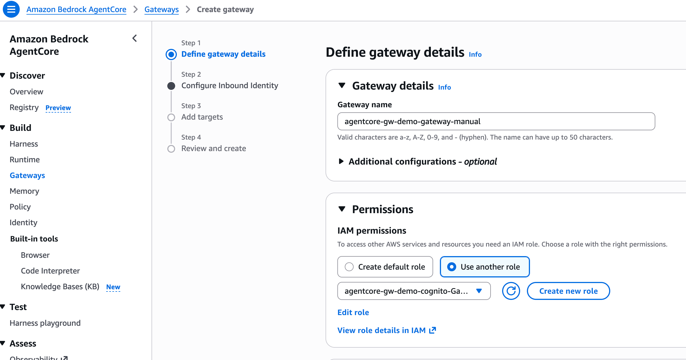

**Step 2 - Configure Inbound Identity**:**Inbound Auth type** 选
**Use JSON Web Tokens (JWT)**;**JWT schema configuration** 选
**Use existing Identity provider configurations**(复用 `deploy.sh` 建好的
Cognito,不要选 Quick create);**Discovery URL** 填栈输出 `CognitoDiscoveryUrl`。
往下滚动在 **Allowed clients** 填 gateway-client ID。

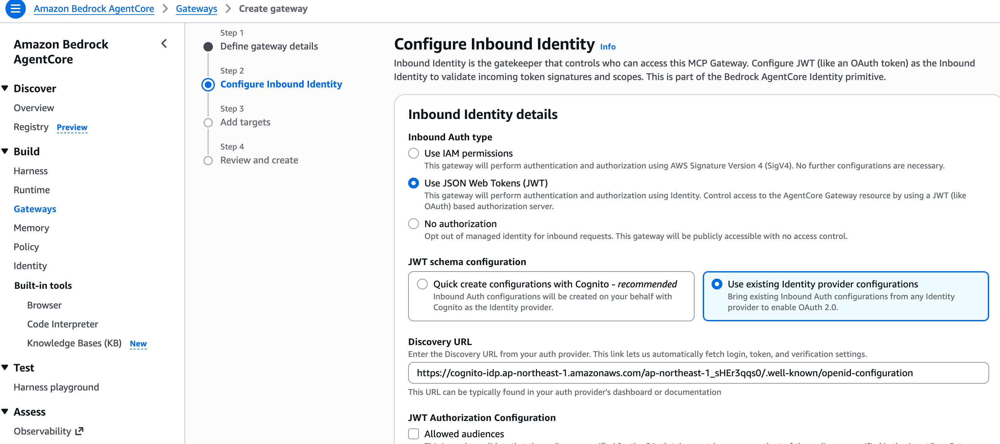

约 1-3 分钟后状态变为 **`READY`**,详情页显示 **MCP endpoint URL**(形如
`https://<gateway-id>.gateway.bedrock-agentcore.ap-northeast-1.amazonaws.com/mcp`),
记下备用。

---

## 步骤 2:复用出站凭证提供者(Token Vault)

`deploy.sh` 已在 AgentCore Identity 的 Token Vault 中创建两个提供者,可直接复用
(它们属于账号/Vault 级别,不绑定单个网关):

| 提供者 | 名称 | 用途 |
|--------|------|------|
| OAuth | `<project>-cognito-oauth` | Target 1/2/3 出站鉴权(Cognito service-client)|
| API Key | `<project>-jira-apikey` | Target 4 出站(Jira Basic 认证)|

在 **AgentCore → Identity → Credential providers** 中确认二者存在,记下各自的
**Credential Provider ARN**(Target 引用时用)。若不存在(例如未配置 Jira),可参考
`gateway/setup-gateway.py` 手动创建;OAuth 提供者用 service-client 的 ID/密钥 +
`CognitoDiscoveryUrl` + scope `<project>/invoke`。

---

## 步骤 3:添加 4 个 Target

在 `<project>-gateway-manual` → **Targets** → **Add target**,依次添加下列 4 个。
端点/规范取值见[附录](#附录取值速查)。全部出站鉴权:Target 1/2/3 选 **OAuth**
(引用 `<project>-cognito-oauth`,scope `<project>/invoke`);Target 4 选 **API Key**。

| # | Name | Target 类型 | 关键配置 |
|---|------|-------------|----------|
| 1 | `langgraph-agent` | **MCP → OpenAPI Schema** | S3 URI:`.../langgraph-agent/openapi.yaml`;出站 OAuth |
| 2 | `claude-agent` | **MCP → OpenAPI Schema** | S3 URI:`.../claude-agent/openapi.yaml`;出站 OAuth |
| 3 | `mcp-server` | **MCP → MCP Server** | Server URL:MCP 服务 `execute-api` 端点 + `/mcp`;出站 OAuth |
| 4 | `jira-cloud` | **MCP → OpenAPI Schema** | S3 URI:`.../jira-cloud/openapi.yaml`;出站 **API Key**(HEADER / `Authorization` / 前缀 `Basic `)|

要点:

- **OpenAPI Target(1/2/4)**:Gateway 把规范里每个操作转成一个 MCP 工具。规范中
  `servers` 的主机必须是可达的 `https://`——服务 1/2 是各自的 `execute-api` 主机名,
  Jira 是 `https://<你的域>.atlassian.net/rest/api/3`。`deploy.sh` 上传规范时已替换
  好占位符。
- **MCP Server Target(3)**:直接与该 MCP 服务握手并聚合其工具,URL 末尾要带 `/mcp`。
- 未配置 Jira 时可跳过 Target 4。

> **为什么 Jira 用 OpenAPI Target,而不是 console 里的 "Integrations" connector?**
> 添加 Target 时 console 会看到 **Integrations**(API 里是 `mcp.connector`),选 Jira
> provider 就能用 AWS 预置的 Jira 集成,似乎更省事。但**第三方 connector 需要先在
> AWS Marketplace 订阅对应的 partner tool** 才会在账号里变为可用——未订阅时用 API
> 直接建 connector target 会报 `Connector integration jira is not available for this
> account.`(实测 `jira` / `atlassian-jira` / `com.atlassian.jira` 等所有变体都如此;
> 而 AWS 原生的 `bedrock-knowledge-bases` 只报缺参数,可见这是账号级订阅门槛,不是
> ID 拼写问题)。此外 AWS 官方 Jira 集成走的是 **3-legged OAuth**(需 Jira 管理员安装
> Forge app 并授权一组 scope),与本 Demo 的 **API token / Basic 认证** 机制不同。因此
> 本方案对 Jira 统一采用可脚本化、用 API-key 出站的 **OpenAPI → MCP** Target。若你的
> 账号已在 Marketplace 订阅了 Jira connector,可自行改用 Integrations Target。

**Step 3 - Add targets 入口**:**Select a target protocol** 选 **MCP target**;
**Passthrough** 保持 **Do not use passthrough - default aggregated**——聚合模式才会
把每个 Target 的工具暴露成 MCP 工具(这也是前文"HTTP Passthrough 不适用"的原因)。

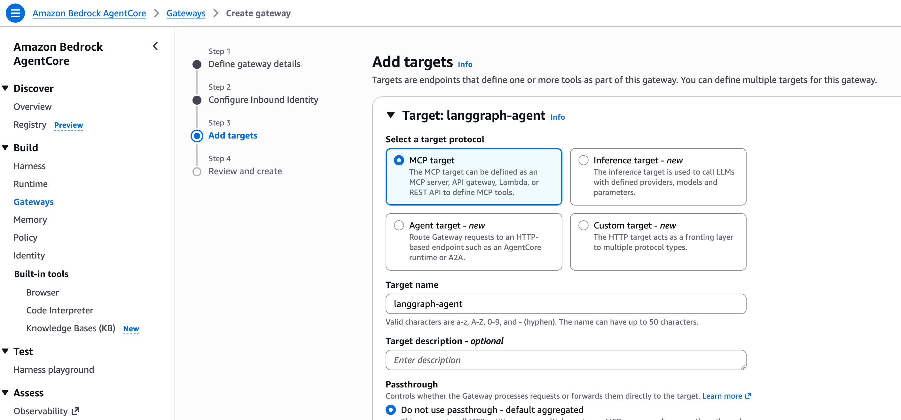

**Target 1 `langgraph-agent`(REST API → OpenAPI schema)**:**Target type** 选
**REST API** → **OpenAPI schema** → **Define with an S3 resource**,填规范的
S3 URI;**Outbound Auth** 选 **OAuth client**。

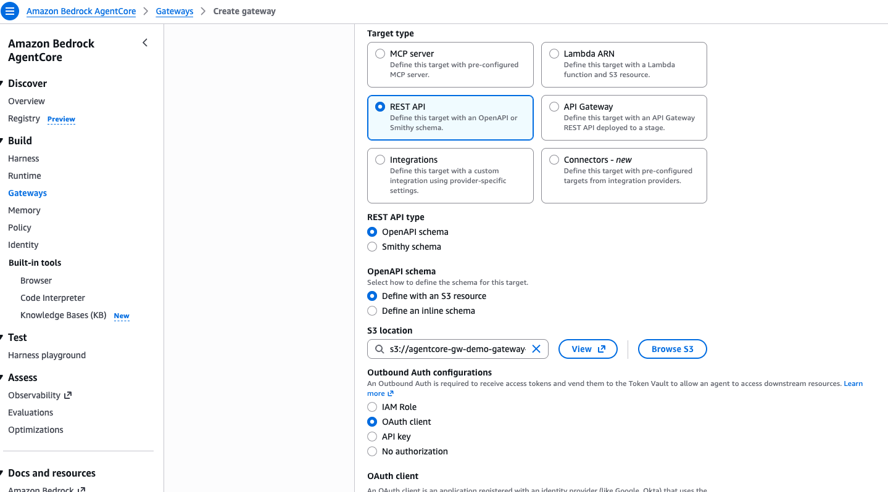

> 这张图里同时能看到 **Integrations** 与 **Connectors - new** 两个 Target type,
> 即下方说明中被 Marketplace 订阅门槛拦住的那条路径。

**Target 2 `claude-agent`**:同 Target 1,只是 S3 URI 换成
`.../claude-agent/openapi.yaml`;**OAuth client** 下拉选 `<project>-cognito-oauth`
(步骤 2 里复用的出站凭证提供者)。

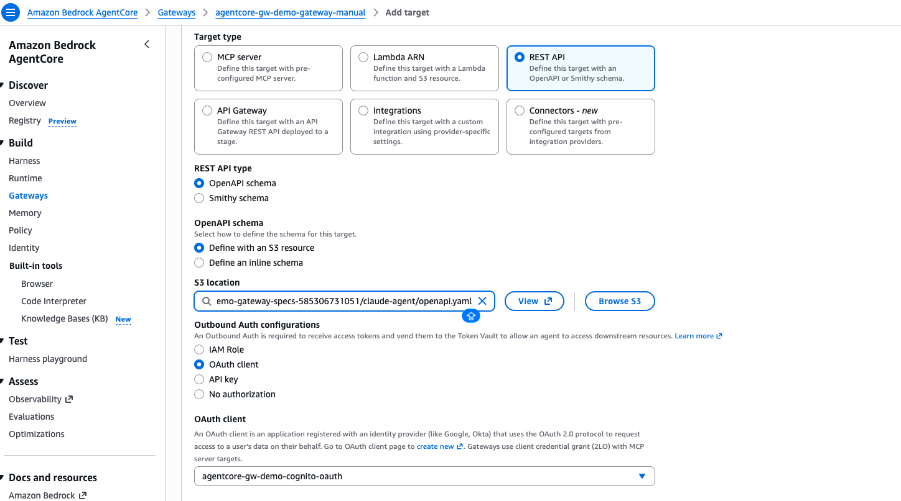

**Target 3 `mcp-server`(MCP server)**:**Target type** 选 **MCP server**,
**MCP endpoint** 填 MCP 服务的 `execute-api` 端点 **加 `/mcp` 后缀**;
**MCP listing mode** 用 **Default**(工具缓存在控制平面,需 Sync);
**Outbound Auth** 同样选 **OAuth client**。

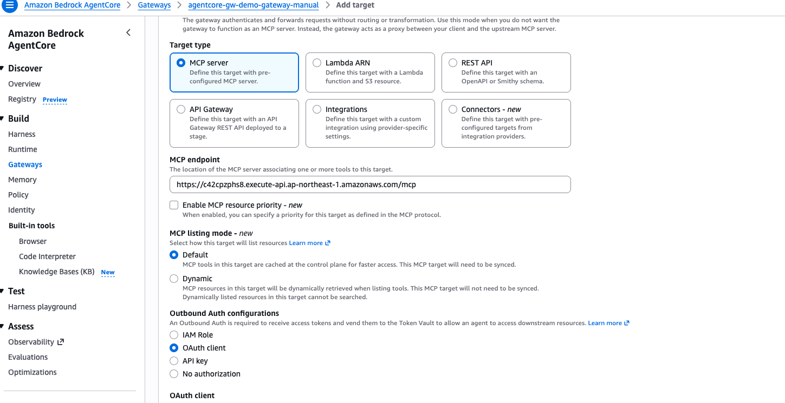

Target 4 `jira-cloud` 与 Target 1/2 同为 REST API → OpenAPI schema,区别只在
**Outbound Auth 选 API Key**(HEADER / `Authorization` / 前缀 `Basic `)。

每个 Target 创建后进入同步,最终 4 个全部变为 **`Ready`**:

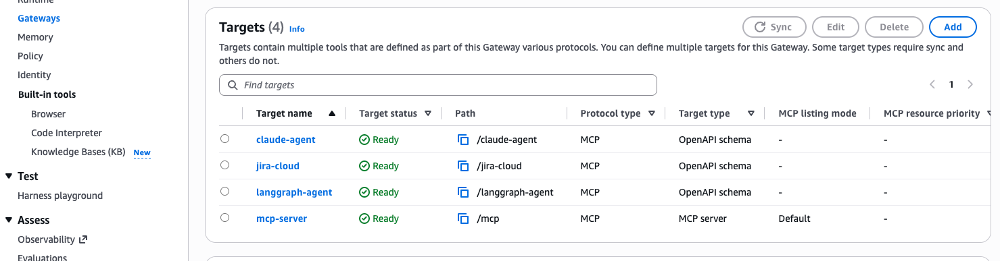

---

## 步骤 4:验证

Target 全部 `READY` 后,用 gateway-client 换取入站令牌并调用网关(注意必须带
`MCP-Protocol-Version: 2025-06-18` 头,否则报 400 版本不支持):

```bash
TOKEN=$(curl -s -X POST "<CognitoTokenUrl>" \
  -H "Content-Type: application/x-www-form-urlencoded" \
  -u "<GatewayClientId>:<GatewayClientSecret>" \
  -d "grant_type=client_credentials&scope=<project>/invoke" | jq -r .access_token)

curl -s "<你的-manual-网关-MCP-endpoint>" \
  -H "Authorization: Bearer $TOKEN" \
  -H "Content-Type: application/json" \
  -H "Accept: application/json, text/event-stream" \
  -H "MCP-Protocol-Version: 2025-06-18" \
  -d '{"jsonrpc":"2.0","id":1,"method":"tools/list","params":{}}'
```

预期:返回聚合自 4 个 Target 的工具列表(工具名形如 `langgraph-agent___chat`、
`jira-cloud___searchIssues` 等)。

> 项目自带的 `gateway/validate.py` 也可做同样校验(默认针对自动创建的网关)。

---

## 步骤 5:在 Amazon Quick 中连接并测试

Amazon Quick 通过 **MCP connector** 直接连到网关,由 Quick 自己用 client
credentials 换取令牌,无需手工贴 `Bearer` 头。

### 5.1 打开 Connectors

左侧导航 **More** → **Connectors**。

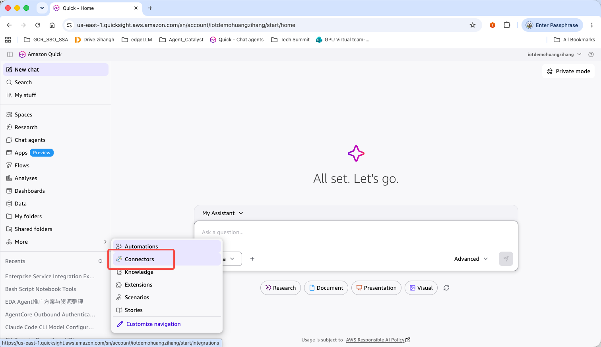

### 5.2 新建 Model Context Protocol connector

**Create for your team** 标签页 → 选 **Model Context Protocol** 卡片。

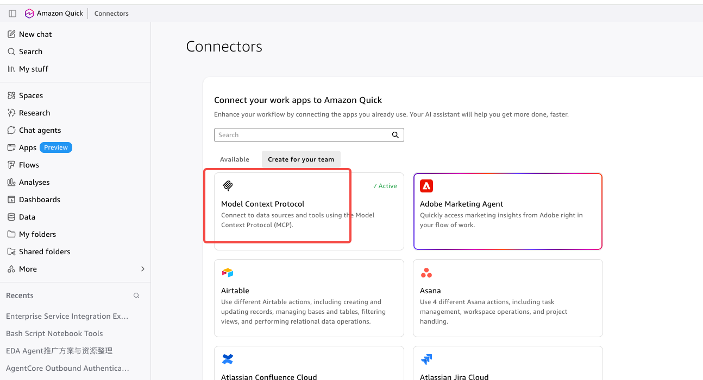

若此前已有 MCP 连接,会弹出提示;要新建就点 **No, create new**。

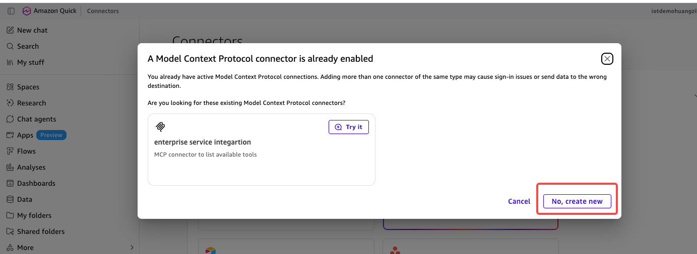

### 5.3 Connect - 填网关端点

| 字段 | 值 |
|------|-----|
| **Name** | 任意,例如 `enterprise-service-integration` |
| **MCP server endpoint** | 网关的 MCP endpoint(**含 `/mcp` 后缀**)|
| **Connection type** / **Auth connection type** | **Public network** |

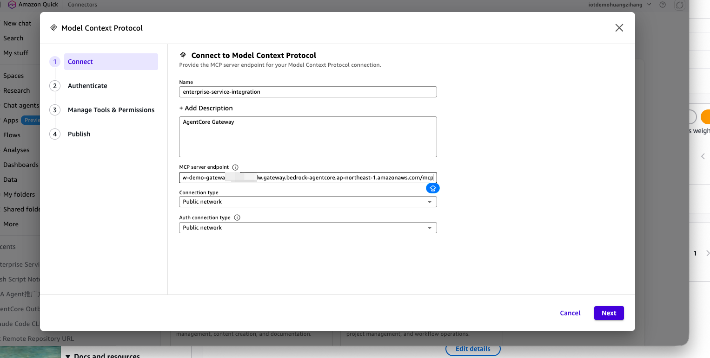

### 5.4 Authenticate - 必须选 Service authentication

| 字段 | 值 |
|------|-----|
| **Authentication method** | **Service authentication**(见下方说明)|
| **Auth configuration** | **Service-to-service OAuth** |
| **Client ID** / **Client secret** | **gateway-client** 的 ID 与密钥 |
| **Token URL** | 栈输出 `CognitoTokenUrl` |

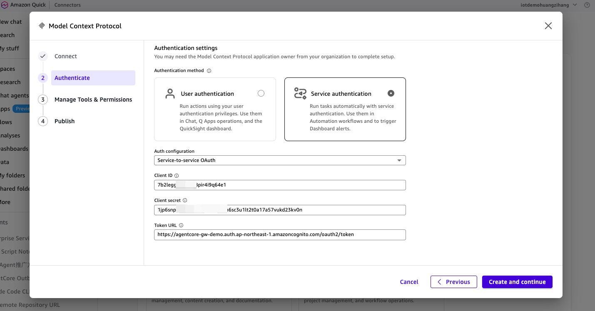

> **为什么不能选 User authentication?** 本项目的 gateway-client 是 M2M 客户端,
> 只启用了 `client_credentials` 流程,且没有配置回调 URL。而 **User authentication /
> Custom user based OAuth** 走的是 authorization_code,需要 Authorization URL 与
> Redirect URL,填不出来也无法完成授权。选 **Service authentication** 才与
> `client_credentials` 对应。

### 5.5 Manage Tools & Permissions

Quick 会列出从网关聚合到的全部工具,并按 **Read / Write** 分类(Write 类操作在会话
中调用前会请求确认)。工具名形如 `claude-agent___sendMessage`、
`jira-cloud___createIssue`、`mcp-server___search_knowledge_base`。

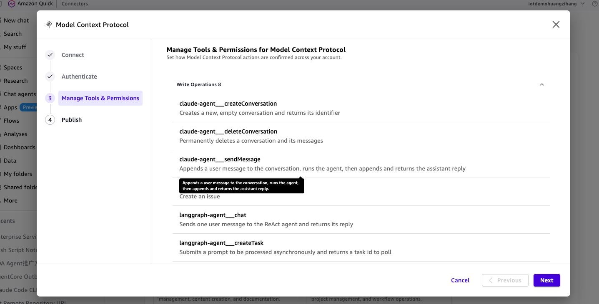

### 5.6 Publish

选择可访问范围后点 **Publish**。

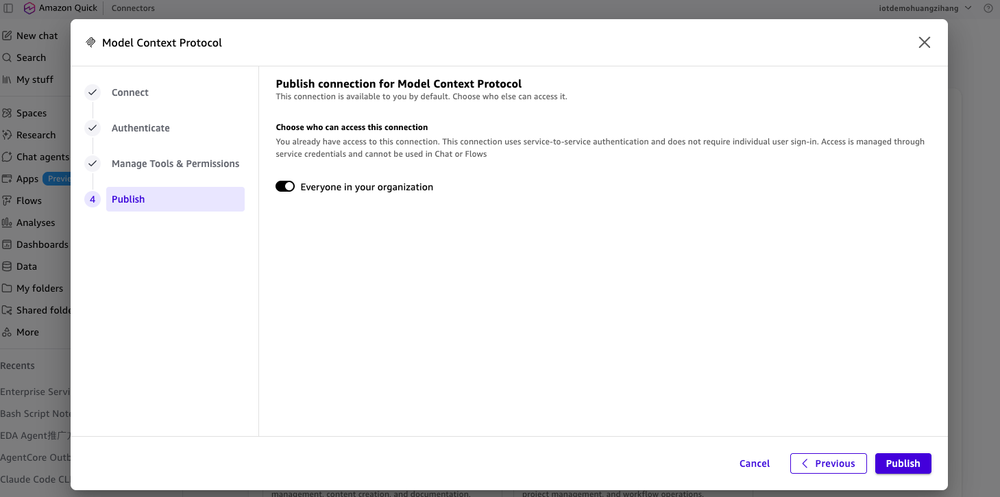

> 注意页面上的说明:service-to-service 认证的连接用于 **Automated workflows**,
> **不能直接用在 Chat 或 Flows 里**;要在对话中试用,请通过 **Chat agents** 挂载该
> connector(下面 5.8 的截图就是这样跑的)。

### 5.7 确认连接就绪

连接详情页 **Status** 应为 **Ready**,右侧 **Enabled tools** 列出全部聚合工具,
可用 **Test action APIs** 直接试调。

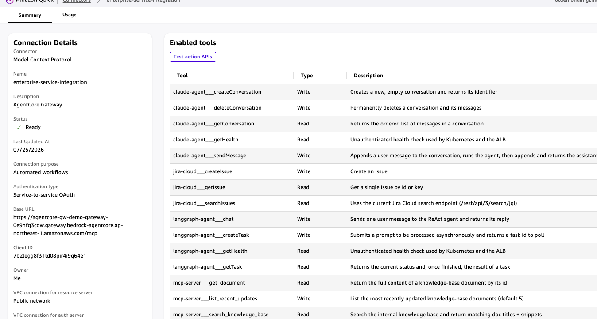

### 5.8 端到端测试

在会话中让 Quick 调用不同服务的工具,验证四条链路:

**Service 2(Claude Agent,真实 Bedrock)**——创建会话并提问,Agent 返回订单状态:

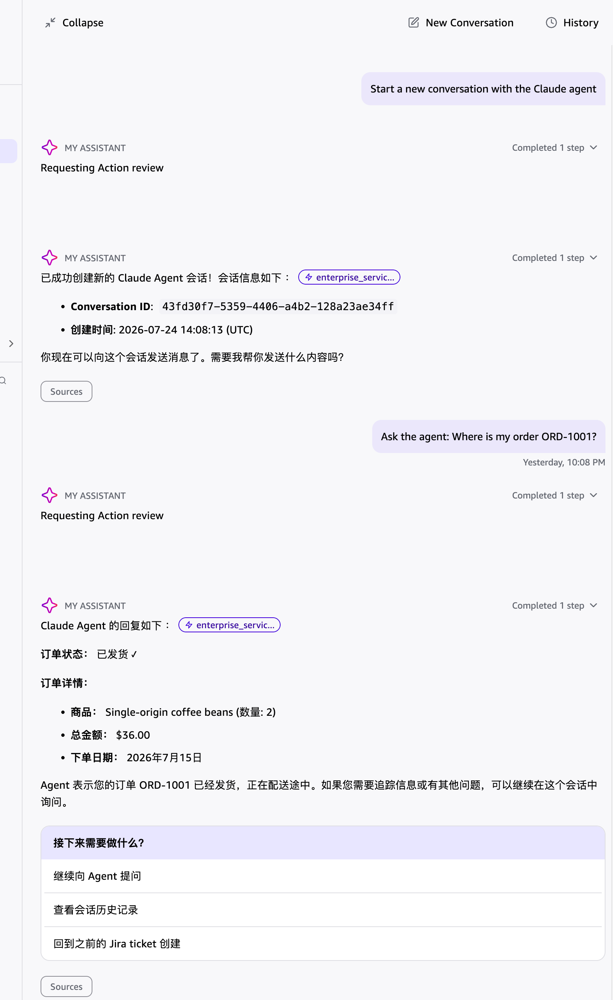

**Service 1(LangGraph)+ Service 4(Jira)**——先问天气(LangGraph ReAct
agent 调用 mock 工具),再在 `ACGW` 项目里创建 Bug ticket,成功返回 `ACGW-2`:

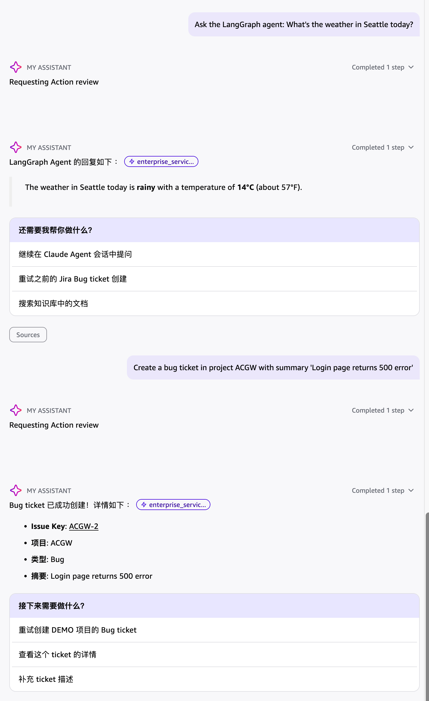

> Jira 建单请务必指定项目 key `ACGW` 与合法 issue type(如 `Bug`/`Task`);用
> discovery 项目或非法类型会被 Jira 以 HTTP 400 拒绝,而网关会把它显示成笼统的
> "internal error"。详见下方常见问题。

---

## 附录:取值速查

`deploy.sh` 把值写入 `cdk-outputs.json`、`deploy-outputs.env`、
`gateway/generated-apigateway.json`。常用取值:

| 值 | 来源 |
|----|------|
| User Pool ID | `cdk-outputs.json` → `<project>-cognito`.`UserPoolId`(`deploy-outputs.env`:`COGNITO_USER_POOL_ID`)|
| Discovery URL | 栈输出 `CognitoDiscoveryUrl` |
| Token URL | 栈输出 `CognitoTokenUrl` |
| Scope | `CognitoScope` = `<project>/invoke` |
| gateway-client ID | 栈输出 `GatewayClientId` |
| service-client ID | 栈输出 `ServiceClientId` |
| Gateway 执行角色 ARN | 栈输出 `GatewayRoleArn` |
| 各服务 execute-api 端点 / API ID | `gateway/generated-apigateway.json` → `<service>.endpoint` / `.apiId` |
| OpenAPI 规范 S3 URI | `s3://<project>-gateway-specs-<accountId>/<service>/openapi.yaml` |

**读取示例:**

```bash
jq -r '."agentcore-gw-demo-cognito".GatewayRoleArn' cdk-outputs.json
jq -r '."mcp-server".endpoint' gateway/generated-apigateway.json
# 客户端密钥(勿落盘):
aws cognito-idp describe-user-pool-client --user-pool-id <userPoolId> \
  --client-id <GatewayClientId> --region ap-northeast-1 \
  --query 'UserPoolClient.ClientSecret' --output text
```

## 常见问题

- **工具调用报 "An internal error occurred"**:网关执行角色缺少对
  `bedrock-agentcore-identity!default/*` 的 `secretsmanager:GetSecretValue`(取不到
  出站凭证);或(OpenAPI Target)缺 `s3:GetObject`。开启网关日志投递
  (CloudWatch delivery-source,`APPLICATION_LOGS`)可看到真实错误。
- **`tools/list` 报 400 Unsupported protocol version**:请求需带头
  `MCP-Protocol-Version: 2025-06-18`。
- **入站 401**:令牌须由 **gateway-client** 签发且在网关 Allowed clients 列表中,
  并带 `<project>/invoke` scope。
- **`mcp-server` Target 调用报错 / 服务返回 `421 Misdirected Request`**:MCP SDK
  `mcp >= 1.23` 默认启用 **DNS rebinding 防护**(校验 Host 头,修复
  GHSA-9h52-p55h-vw2f)。FastMCP 的 `host` 默认是 `127.0.0.1`,此时会**自动开启**
  该防护且只允许 localhost——经 API Gateway / 内部 ALB 转发进来的请求会全部 421。
  本项目已把它显式化为环境变量:`MCP_ALLOWED_HOSTS`(逗号分隔的 Host 白名单,
  支持 `host:*` 任意端口写法;`deploy.sh` 在 API Gateway 创建后自动填入
  execute-api 与 ALB 两个主机名并重新 apply Deployment)、
  `MCP_DNS_REBINDING_PROTECTION`(设为 `false` 可整体关闭)。注意白名单**不支持
  域名通配符**,只支持精确主机与 `host:*`。`/health` 在 MCP mount 之外,不受影响。
- **Target `FAILED`**:检查执行角色权限、S3 规范可达、`servers` 主机为有效
  `https://` 端点;修复后点 **Sync**。
- **Jira `searchIssues` 报错**:Atlassian 已移除旧的 `/rest/api/3/search`,须用
  `/rest/api/3/search/jql`(本项目规范已更新),且 JQL 需有界(加项目或时间限制),
  例如 `project = ACGW ORDER BY created DESC`。
- **Jira `createIssue` 报 "internal error"**:网关把 Jira 的 HTTP 400 屏蔽成了通用
  错误。常见原因是项目/issue type 不合法——discovery 项目只支持 `Idea`。`deploy.sh`
  已幂等创建软件项目 `JIRA_PROJECT_KEY`(默认 `ACGW`,支持 `Task/Story/Bug`),
  调用时用该 project key + 合法 issue type 即可。
